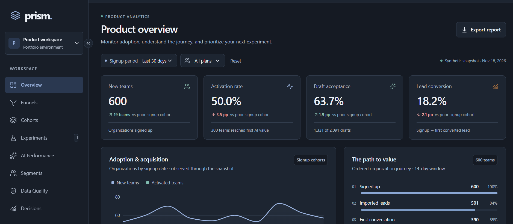
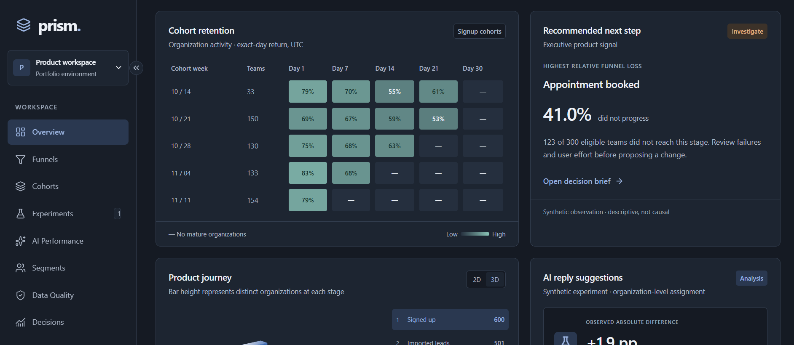

# CRM Product Intelligence & Experimentation Platform

**Prism** is a responsive product analytics portfolio frontend built with React, TypeScript, Tailwind CSS, Motion, Recharts, Three.js, React Three Fiber, and Drei.

> All organizations, events, and results are synthetic. Nothing on these screens represents a client, a production experiment, or a live integration.

## Dashboard preview

### Product overview



### Cohort retention and product recommendations



## Setup

Use Node.js 22.12+ or 24 LTS and npm.

```sh
npm ci
npm run dev
```

No database, API key, environment variable, or external service is required.

```sh
npm run build
npm run preview
npm test
npx playwright install chromium
npx playwright test
```

The browser checks start their own local production preview server after you build. The production output is `dist/`, suitable for static hosting; navigation uses URL hashes, so no server rewrite is required.

## What works

- Overview: cohort KPIs, previous-period comparisons, acquisition/activation trends, ordered journey, retention matrix, and a computed friction insight.
- Funnels: distinct organization counts, 14-day ordered stages, conditional conversion, and previous signup-cohort counts.
- Cohorts: exact-day organization retention, mature denominators, heatmap, and aggregate retention curve.
- Experiments: deterministic organization assignment, mature 14-day binary outcomes, observed absolute difference and a 95% normal confidence interval, with sample sufficiency checks.
- AI Performance: accepted, edited, discarded and failed drafts, acceptance rate, failure rate and median successful generation latency.
- Segments: subscription-plan comparisons calculated from the same event source.
- Data Quality: event uniqueness, organization references, snapshot boundary, and generation latency checks.
- Decisions: largest relative funnel drop, observed denominator, illustrative opportunity sizing, and a validation proposal.
- Global signup-period and subscription-plan filters; metric definition dialogs; downloadable JSON report; collapsible navigation; mobile menu; light/dark theme saved when browser storage is available.

## Visual experience

Modern Analytical Minimalism, with a light-first background (#F7F8FA), white analytical cards, a charcoal dark theme (#151A23), blue primary accents (#4769A8), teal secondary accents (#65A69B), and warm highlights (#E3A46D). Shared CSS tokens govern every screen. Thin borders and subtle shadows define hierarchy; glass blur is reserved for search results, modal dialogs and overlays.

Overview starts with compact KPIs, adoption/acquisition trends and the ordered funnel. Cohort retention, an executive recommendation, an inspectable product journey and the synthetic experiment scorecard follow. There is no marketing hero, particle field or floating KPI decoration.

Chart legends toggle individual series. The journey supports a 2D/3D switch, mouse hover on bars, smooth drag rotation and keyboard-accessible stage buttons with an explicit count and conversion readout. Camera rotation uses damped controls; rendering is on demand, pixel density is capped at 1.5, and no external models or textures are downloaded. Mobile and reduced-motion views use the 2D representation and never request the 3D bundle. WebGL failures retain readable counts and stage controls.

The sidebar collapses on desktop and becomes an Escape-dismissable mobile menu. Closed mobile navigation is inert. Charts include HTML data tables; native selects, buttons, links and modal dialogs support keyboard use. New sessions start in light mode, while explicitly saved theme preferences are preserved.

Implementation references: [Tailwind Vite integration](https://tailwindcss.com/docs/installation/using-vite) and [React Three Fiber on-demand rendering](https://r3f.docs.pmnd.rs/advanced/scaling-performance).

## Data and definitions

`src/analytics.ts` generates 1,800 organizations and their events using an LCG seeded with 42. A fixed snapshot of **November 18, 2026, 00:00 UTC** makes the demonstration reproducible. Data is generated locally; refreshing does not change the seed.

Filters select **signup cohorts**, not event-time activity. Draft outcomes are observed through the snapshot. Recent funnel cohorts may still be maturing. Retention and experiment calculations explicitly enforce their complete observation windows. A 90-day view has no previous 90-day fixture; cards disclose that no previous cohort is available.

See [metric dictionary](docs/metric-dictionary.md), [architecture and scope](docs/upgrade-plan.md), and [delivery status](docs/implementation-status.md).

## Architecture

- `src/App.tsx`: navigation, filters, screen composition, dialogs and report export.
- `src/analytics.ts`: seeded event generator and shared analytical calculations.
- `src/Charts.tsx`: lazy-loaded Recharts visualization and accessible data tables.
- `src/Spatial.tsx`: lazy-loaded React Three Fiber scene.
- `src/styles.css`: Tailwind integration, design tokens, glass surfaces, themes and breakpoints.
- `tests/analytics.test.ts`: analytical invariants and edge cases.
- `tests/browser.spec.ts`: desktop/mobile navigation and interaction checks.

## Portfolio walkthrough

Start on Overview. Change the signup period and plan, inspect a KPI definition, and export the computed report. Open Funnels to identify the largest relative drop. In Cohorts, inspect the mature denominators and compare the retention curve. In Experiments, explain the organization assignment and the difference between draft acceptance and an organization-level binary outcome. Finish in Decisions with a measurable observation and a proposed validation plan.

## Boundaries

This repository initially contained only a case-study README. No running frontend or backend existed to preserve. The original case study remains in [docs/original-case-study.md](docs/original-case-study.md).

This delivery is the explicitly authorized new synthetic-data frontend. It does not implement the broader pasted full-stack roadmap: PostgreSQL, ingestion APIs, authentication, instrumentation delivery, SQL migrations, live CRM integrations, LLM providers, actual customer messaging, opt-out enforcement, or production monitoring. There is no backend or persistence beyond the theme preference. The experiment uses an illustrative generator, not a production randomized trial; it does not implement power analysis, p-values, sequential inference, or guardrail decisions.

## Validation

The strict TypeScript production build, seven analytics tests and three Chromium production-preview smoke tests pass. The mobile check confirms no Spatial bundle is requested. Full results and remaining development dependency findings are recorded in [implementation status](docs/implementation-status.md). The shared palette, component styling and interaction rules are documented in [design system](docs/design-system.md).

